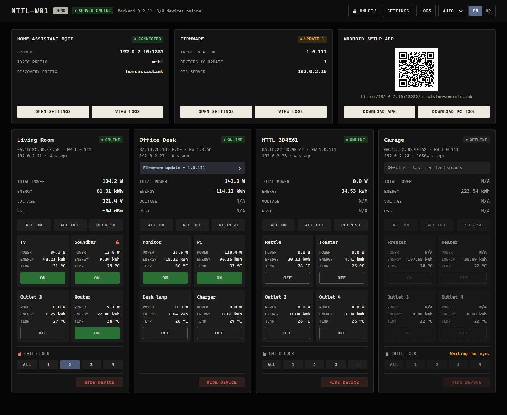

# LG U+ MTTL-W01 for Home Assistant

[한국어](README.ko.md)

A Home Assistant app (add-on) that runs Tuo's standalone backend for the LG U+ MTTL-W01 power strip. The power strips connect to Home Assistant over your own network instead of the LG U+ cloud. A dashboard in the Home Assistant sidebar switches the four outlets and shows power, energy and temperature. With the Mosquitto broker app installed, the outlets and their sensors also appear in Home Assistant through MQTT discovery.

Each power strip needs Tuo's firmware 1.0.111, installed once with Tuo's PC tool. The [install guide](docs/install.md) covers the app and the power strips. The app version is the Tuo backend version followed by the packaging revision (`version` in [mttl_w01/config.yaml](mttl_w01/config.yaml)).

This is an unofficial project, not affiliated with LG U+ or Tuo.

## Supported systems

- Home Assistant OS, or another installation that runs apps, on amd64 or aarch64 (for example Home Assistant Green and Raspberry Pi). aarch64 has not been tested on real hardware yet.
- LG U+ MTTL-W01 power strips.

## Quick start

1. Add this repository to Home Assistant with [this link](https://my.home-assistant.io/redirect/supervisor_add_addon_repository/?repository_url=https%3A%2F%2Fgithub.com%2Fkkqq9320%2Fha-lgu-mttl-w01), or add `https://github.com/kkqq9320/ha-lgu-mttl-w01` under **Settings → Apps → Install app → ⋮ → Repositories**.
2. Install **LG U+ Multitap (MTTL-W01)**.
3. On the app's **Info** tab, turn on **Watchdog** and **Show in sidebar**.
4. Start the app.
5. Open **MTTL-W01** in the sidebar.

Then install the firmware on each power strip and connect it, as described in [Prepare the power strips](docs/install.md#prepare-the-power-strips).

There is no login. Changes work only in the Home Assistant sidebar, which Home Assistant's login protects, and port 18282 is for viewing and downloading. See [Access and screen lock](docs/install.md#access-and-screen-lock).

## Credits

This app is built on Tuo's standalone backend, PC tool and Android setup app. Its dashboard adapts the layout and CSS of [af950833's dashboard](https://github.com/af950833/mttl_w01). [NOTICE.md](NOTICE.md) lists the files that come from Tuo, which of them are modified, and why.

## License

The code and documents written for this repository are under the [MIT License](LICENSE). Tuo's files and the parts adapted from af950833 belong to their authors, as described in [NOTICE.md](NOTICE.md).
